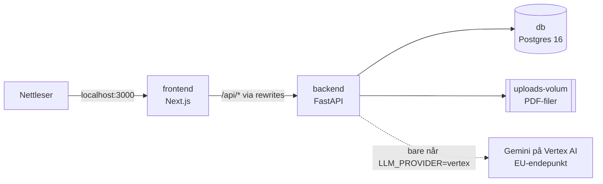
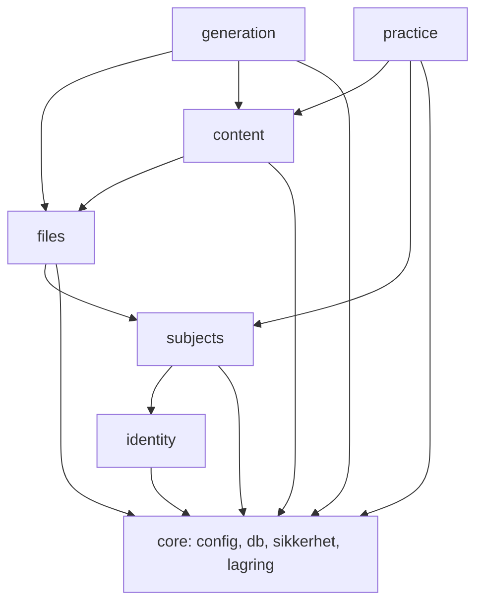
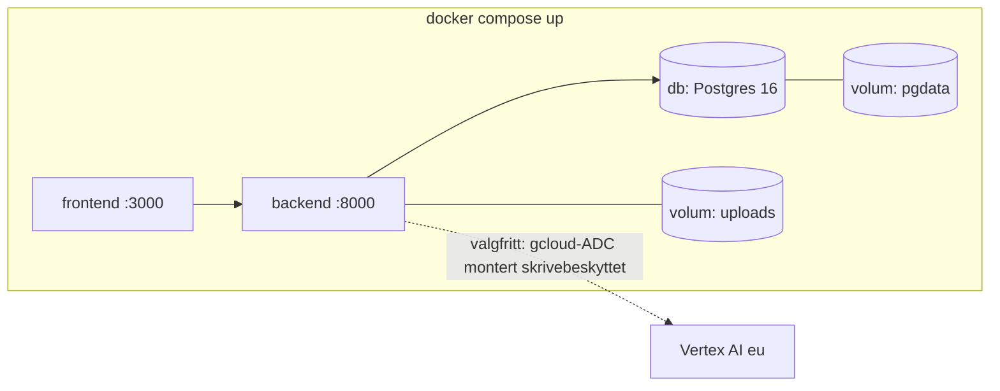
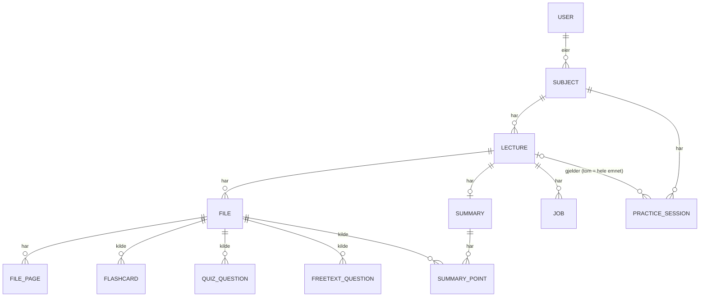

# Arkitektur: Studiekamerat

Bygger på faglærers [technology.md](../technology.md). Det som står der, gjelder med mindre et avvik er nevnt her. Begrunnelsene for valgene står i [.memlog.md](.memlog.md) og i `docs/ki-prosess/beslutninger.md`.

## Designparadigme

To programmer, slik technology.md har det: **frontend** (Next.js) viser sidene, og **backend** (FastAPI) eier all logikk og alle data. Begge er delt i **vertikale moduler**, altså én mappe per fagområde, og modulene i frontend speiler backend.



Avhengigheter mellom backend-modulene. En pil betyr «kan kalle»:



## Invarianter og regler

### AD-1: Backenden eier all logikk og alle data [ADOPTED]

- **Binds:** alle moduler, NFR-4
- **Prevents:** at modellkall, kontroll, lagring eller tilgangssjekk havner i frontend
- **Rule:** Frontend snakker bare med `/api/*` på samme adresse. Den leser aldri databasen, filene eller språkmodellen direkte. Next.js sender `/api/*` videre til `API_INTERNAL_URL` (`http://backend:8000`) med `rewrites`. Det er ingen Caddy og ingen CORS i normal bruk (avvik fra technology.md: Caddy er kuttet).

### AD-2: Alt eies av én bruker, og hver spørring filtreres på den

- **Binds:** FR-4, FR-5, SK-2, alle moduler som har data
- **Prevents:** at noen moduler sjekker eierskap og andre ikke
- **Rule:** Alle rader hører til en bruker gjennom kjeden bruker → emne → forelesning → fil → innhold. Hver rute henter innlogget bruker fra én felles avhengighet (`current_user`), og hver spørring filtrerer på brukeren. Forsøk på å åpne andres data gir `404`, ikke `403`, slik at det ikke avslører at dataene finnes.

### AD-3: Språkmodellen ligger bak én port, valgt med `LLM_PROVIDER`

- **Binds:** NFR-2, NFR-2a, NFR-4, NFR-5, SK-4, SK-21
- **Prevents:** at noen moduler kaller Gemini direkte, eller at demomodus og ekte modell oppfører seg ulikt
- **Rule:** Bare `generation`-modulen kaller modellen, og det skjer gjennom pydantic-ai (som i technology.md). `LLM_PROVIDER=mock|vertex`, med `mock` som standard. `vertex` bruker `GoogleCloudProvider(location='eu')` med Application Default Credentials og modellnavnet fra `VERTEX_MODEL`. Det globale endepunktet brukes aldri, og mellomlagring er slått av i Google Cloud-prosjektet. Mock-modellen følger reglene i NFR-2a og gir samme svar for samme fil. Den har også en variant som med vilje gir ugyldige svar (SK-4). Avvik fra technology.md: Vertex AI i stedet for OpenRouter, på grunn av NFR-5.

### AD-4: Én vei fra notater til lagret innhold

- **Binds:** FR-18, FR-21, FR-29, FR-38, FR-45, FR-48, FR-53, SK-3, SK-4, SK-8
- **Prevents:** at innholdstypene kontrolleres ulikt, eller at halvferdig innhold blir lagret
- **Rule:** All generering går gjennom samme løp. Først hentes sidetekst fra `file_pages`, så sendes forespørselen til porten (AD-3). Deretter kontrolleres hvert element i kode, og alt som består, lagres i **én transaksjon**. Skjemaet for hver innholdstype defineres én gang som en Pydantic-modell, som brukes både som `output_type` mot modellen og som kontroll. Elementer som ikke består, forkastes og telles. Feiler kallet, eller tar det over 3 minutter (`asyncio.wait_for`), lagres ingenting.

### AD-5: Generering er en jobb i databasen, én aktiv per forelesning

- **Binds:** NFR-17, FR-21
- **Prevents:** to jobber på samme forelesning, eller ulik statusmodell i frontend og backend
- **Rule:** En jobb er en rad i `jobs` med status `running`, `done` eller `failed`, i tillegg til antall laget og antall forkastet. Den kjøres som en asyncio-oppgave i backend-prosessen, uten Redis og uten egen worker. En delvis unik indeks på `lecture_id` der status er `running` hindrer to aktive jobber. Jobber som står som `running` når backenden starter, settes til `failed`. Frontend spør etter status med TanStack Query (polling) mens jobben pågår.

### AD-6: Sidetekst lagres én gang, og alt innhold peker på fil og side

- **Binds:** FR-10, FR-20, FR-32, FR-39, FR-40, FR-54, NFR-16
- **Prevents:** at sidetall kontrolleres mot en annen tekst enn den modellen fikk
- **Rule:** Ved opplasting leser PyMuPDF teksten fra hver side og lagrer den i `file_pages(file_id, page_no, text)`. `page_no` er PDF-sidenummeret og starter på 1. Filer med over 50 sider eller uten lesbar tekst avvises der. Alt generert innhold lagrer `file_id` og `page_no`, og kontrollen sjekker at siden finnes. Bilde av en side (FR-40) lages ved behov fra den lagrede PDF-en og lagres ikke. Avvik fra technology.md: PyMuPDF i stedet for pypdf.

### AD-7: Innhold eies av kildefila, og sletting går nedover kjeden

- **Binds:** FR-5, FR-12, FR-13, FR-14, SK-6
- **Prevents:** innhold som blir liggende igjen, eller sletting som gjøres forskjellig fra sted til sted
- **Rule:** Fremmednøkler har `ON DELETE CASCADE` hele veien fra bruker til innhold. Generert innhold er knyttet til fila det kom fra, og forsvinner med den. Fila på disken slettes etter at transaksjonen er fullført. Sletting av konto fjerner hele brukermappa. Før hver sletting kan frontend be om en opptelling av hva som slettes (`GET …/delete-preview`), og selve slettingen er et eget kall.

### AD-8: PDF-filer ligger på et volum bak én lagringsmodul

- **Binds:** FR-8, FR-13, NFR-2
- **Prevents:** at moduler skriver filer på egen hånd, eller at brukerens filnavn havner i stier på disken
- **Rule:** Bare `core/storage` leser og skriver filer, med stien `data/uploads/<user_id>/<file_id>.pdf`. Det opprinnelige filnavnet lagres bare i databasen. Avvik fra technology.md: et Docker-volum i stedet for Supabase Storage, fordi lokal Supabase krever hemmeligheter (NFR-2).

### AD-9: Økter lagres bare som resultat

- **Binds:** FR-25, FR-51, FR-56, FR-57, FR-58, SK-20
- **Prevents:** at enkeltsvar lagres, eller at «øvd» beregnes ulikt fra sted til sted
- **Rule:** Frontend teller underveis i økten og sender **ett** resultat når økten er ferdig, når studenten velger «Avslutt», eller ved `pagehide` (med `sendBeacon`), og bare hvis minst ett svar er gitt. Backenden lagrer bare dette resultatet. «Øvd», semesterlinja og «Neste å øve på» beregnes i backend (`practice`), aldri i frontend.

### AD-10: Innlogging med app-JWT i en httpOnly-cookie

- **Binds:** FR-3, FR-4, NFR-7
- **Prevents:** at innloggingen lagres og leses ulikt
- **Rule:** Passord lagres som bcrypt-hash og må ha minst 8 tegn. Ved innlogging lager appen en HS256-JWT med PyJWT (som i technology.md) og legger den i en cookie med `HttpOnly` og `SameSite=Lax`. Den legges ikke i `localStorage`. `JWT_SECRET` har en standardverdi bare når `APP_ENV=local`, og ellers nekter appen å starte uten nøkkel (som i technology.md).

### AD-11: Én kilde for innstillinger og brytere

- **Binds:** NFR-2, NFR-4, kuttrekkefølgen i PRD-en
- **Prevents:** at frontend og backend er uenige om hvilke funksjoner som er på
- **Rule:** Alle innstillinger leses med pydantic-settings fra miljøet. `.env` er valgfri, og uten den starter appen i demomodus. Brytere finnes bare for bør ha-funksjonene: `FEATURE_MNEMONICS`, `FEATURE_FREETEXT` og `FEATURE_SUMMARY`. Frontend leser bryterne fra `GET /api/config` mens appen kjører. Ingen hemmelighet får `NEXT_PUBLIC_`-prefiks. Lite avvik fra technology.md: den har brytere i to lag ved bygging, mens her finnes de bare ett sted.

### AD-12: Backenden sender feilkoder, og frontend eier all norsk tekst

- **Binds:** FR-1, FR-9, FR-10, FR-21, NFR-11, NFR-12
- **Prevents:** samme feil med ulik ordlyd, eller engelsk tekst i grensesnittet
- **Rule:** Feil fra API-et har formen `{"error": {"code": "<SNAKE_CASE>", "details": {…}}}`. Frontend har én fil med meldingstekster per kode, og tekstene der er de som er godkjent i EXPERIENCE.md. Backenden sender aldri tekst som skal vises til brukeren.

### AD-13: Koden virker på både Postgres og SQLite

- **Binds:** SK-1 til SK-22, backend
- **Prevents:** at testene går grønt på SQLite mens appen feiler på Postgres, eller omvendt
- **Rule:** Appen kjører på Postgres, og pytest kjører på SQLite i minnet (aiosqlite), som i technology.md. Bare SQL som fungerer på begge brukes. Databaseendringer gjøres med Alembic og kjøres automatisk når backend-containeren starter.

### AD-14: Appen virker uten internett i demomodus

- **Binds:** NFR-2, NFR-3, SK-11, SK-21
- **Prevents:** skjulte kall ut av maskinen, eller en oppstart som krever konto
- **Rule:** `docker compose up` uten `.env` gir demomodus med testbruker og eksempelemne. Eksempelemnet legges inn ved oppstart når databasen er tom og `APP_ENV=local` (`seed_if_empty`, som i technology.md). Fonter, ikoner og skript følger med appen. Inter hentes fra `@fontsource-variable/inter`, ikke fra Google Fonts.

## Konvensjoner

| Område | Konvensjon |
| --- | --- |
| Språk | Kode, tabeller og API-felt på engelsk. All tekst i grensesnittet på bokmål. Ordliste: emne = `subject`, forelesning = `lecture`, fil = `file`, flashcard = `flashcard` (`kind`: `qa`, `concept`, `model`), quizspørsmål = `quiz_question`, fritekstspørsmål = `freetext_question`, sammendrag = `summary`/`summary_point`, økt = `practice_session`, jobb = `job`. |
| Backend-modul | `app/modules/<modul>/` med `router.py`, `service.py`, `models.py` og `schemas.py`. Ruter samles under `/api/<modul>`. |
| Frontend-modul | `modules/<modul>/` med `types.ts`, `api.ts`, `components/` og `pages/`, som speiler backend (technology.md). Ruter i `app/` er tynne og henter fra `modules/`. |
| ID-er og datoer | UUID som primærnøkkel. Datoer som ISO 8601: `date` for forelesning og eksamen, `datetime` i UTC for tidsstempler. Visningen i frontend er norsk (`dd.mm.åååå`). |
| JSON | `snake_case` i API-et. TypeScript-typene i `types.ts` bruker samme feltnavn. |
| Databasesesjon | Ingen `rollback()` på den delte sesjonen i en forespørsel. Bruk `INSERT … ON CONFLICT DO NOTHING` der det passer (technology.md). |
| Tilfeldig rekkefølge | Rekkefølgen i økter blandes i frontend ved øktstart (FR-23, FR-34). Lagret innhold har fast rekkefølge. |
| Tester | Hvert krav har en test som er merket med krav-ID-en i navnet, for eksempel `test_fr38_…`. Playwright kjører axe på alle sider (NFR-13). Alle tester kjøres med `LLM_PROVIDER=mock`. |
| Logging | Logger skrives til stdout. Notattekst og passord logges aldri. |

## Teknologi

Sjekket mot PyPI og npm 2026-11-14. Kjørebildene er de samme som i technology.md.

| Navn | Versjon |
| --- | --- |
| Python (bilde `python:3.12-slim`), uv | 3.12 |
| FastAPI / Uvicorn | 0.162.7 / 0.54.0 |
| SQLAlchemy (async) / Alembic | 2.1.8 / 1.20.1 |
| asyncpg / aiosqlite | 0.32.0 / 0.22.1 |
| Pydantic / pydantic-settings | 2.14.3 / 2.16.3 |
| PyJWT / bcrypt | 2.15.1 / 5.0.0 |
| pydantic-ai-slim (med Google) / google-genai | 2.68.0 / 3.3.0 |
| PyMuPDF | 2.1 |
| pytest / pytest-asyncio / httpx | 9.2.0 / 1.5.0 / 0.28.1 |
| Node (bilde `node:22-alpine`) | 22 |
| Next.js / React | 16.4.6 / 19.3.1 |
| TypeScript | 5.9.3 |
| Tailwind CSS / shadcn/ui (CLI) | 4.3.5 / 4.23.0 |
| TanStack Query / zod | 5.107.1 / 4.6.7 |
| lucide-react / sonner | 1.73.0 / 2.0.8 |
| @fontsource-variable/inter | 5.3.0 |
| Vitest / Playwright / @axe-core/playwright | 5.1.0 / 1.65.1 / 4.14.0 |
| Postgres (bilde) | 16 |
| Språkmodell | Gemini på Vertex AI, `location='eu'`. Modellen settes i `VERTEX_MODEL`, foreløpig `gemini-3.5-flash` (issue #4). |

## Strukturelt utgangspunkt

### Kjøring



- Bare porten `3000` åpnes ut av Docker.
- For å bruke Vertex må du selv sette `LLM_PROVIDER=vertex`, `GOOGLE_CLOUD_PROJECT` og `VERTEX_MODEL` i `.env`, og montere `~/.config/gcloud` skrivebeskyttet med en `docker-compose.override.yml` som ikke ligger i Git.

### Kjernedata



### Mapper

```text
backend/
  app/core/            # config, db, security, storage, llm-port
  app/modules/         # identity, subjects, files, generation, content, practice
  app/seed/            # eksempelemne og testbruker (NFR-3)
  alembic/
  tests/
frontend/
  app/                 # ruter: (auth), (app)
  modules/             # speiler backend-modulene
  lib/                 # fetch-transport, config, hurtigtaster
  e2e/                 # Playwright + axe
docker-compose.yml
.env.example
```

## Hvor kravene hører hjemme

| Krav | Modul | Styrt av |
| --- | --- | --- |
| FR-3–FR-5, NFR-7 (konto) | `identity` | AD-2, AD-7, AD-10 |
| FR-6, FR-7, FR-14, FR-15 (emner og forelesninger) | `subjects` | AD-2, AD-7 |
| FR-8–FR-13, NFR-16 (opplasting) | `files`, `core/storage` | AD-6, AD-7, AD-8 |
| FR-17–FR-22, FR-28–FR-33, FR-42–FR-49, FR-53–FR-55, FR-38–FR-41 (generering) | `generation` | AD-3, AD-4, AD-5, AD-6 |
| FR-23–FR-27, FR-34–FR-37, FR-50–FR-52 (øving, redigering) | `content` + frontend | AD-2, AD-9 |
| FR-56–FR-58, FR-16 (økter og oversikt) | `practice` | AD-9 |
| FR-1, FR-2, NFR-8–NFR-15 (språk, UU, skjerm) | frontend | AD-12, konvensjonene |
| NFR-1–NFR-4 (kjøring, demomodus) | `core`, `seed`, Docker | AD-3, AD-11, AD-14 |

## Utsatt

- **Konkret Gemini-modell og tenkenivå:** Velges etter kvalitetstesten (issue #3 og #4). Det er bare innstillinger i `.env`, så arkitekturen påvirkes ikke.
- **Regelen for sider med formler (FR-40):** Lages og testes i issue #9. Arkitekturen fastsetter bare at bildet lages fra den lagrede PDF-en (AD-6).
- **Innholdet i instruksene til modellen:** Fastsettes i storyen for hver innholdstype. Skjema og kontroll er fastsatt (AD-4).
- **CI (GitHub Actions):** Er ikke med i technology.md. Avgjøres i planleggingen av stories.
- **Publisering, HTTPS, rate limiting, backup og overvåking:** Er utenfor MVP (PRD). Tas opp igjen hvis appen publiseres, og da må også serveren ligge i EU (NFR-5).
- **Mobil og spredt repetisjon:** Er utenfor MVP eller mulige utvidelser (PRD).
