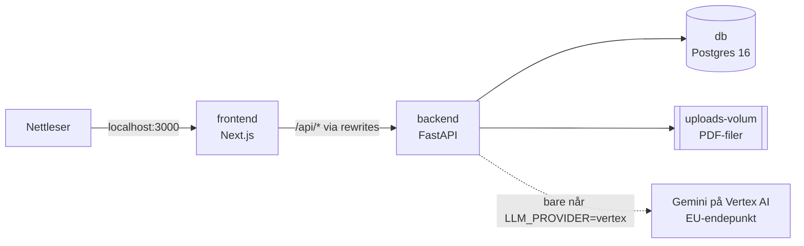
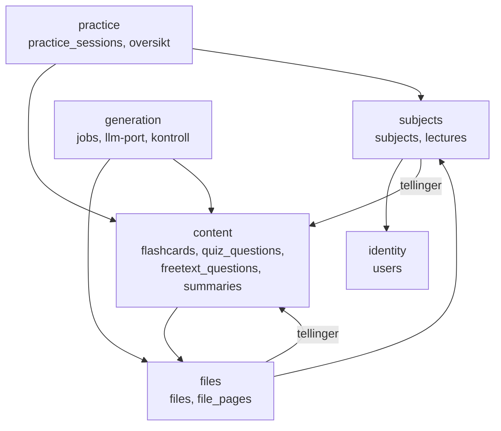
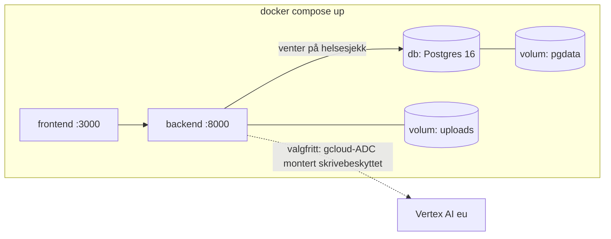
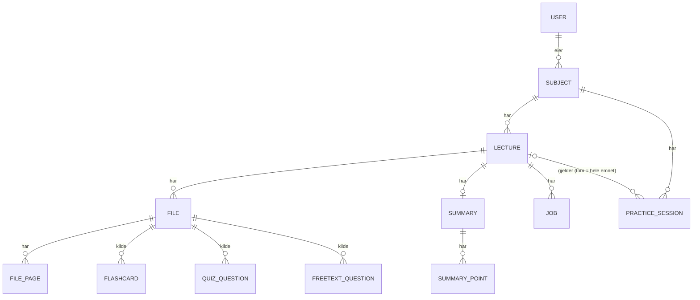

# Arkitektur: Studiekamerat

Bygger på faglærers [technology.md](../technology.md). Det som står der, gjelder med mindre et avvik er nevnt her. Begrunnelsene for valgene står i [.memlog.md](.memlog.md) og i `docs/ki-prosess/beslutninger.md`.

## Designparadigme

To programmer, slik technology.md har det: **frontend** (Next.js) viser sidene, og **backend** (FastAPI) eier all logikk og alle data. Begge er delt i **vertikale moduler**, altså én mappe per fagområde, og modulene i frontend speiler backend. Dette erstatter stakkforslaget i PRD-addendumet (Next.js med Auth.js og Prisma), se `docs/ki-prosess/beslutninger.md` 2026-11-14.



Modulene og hva hver eier. En pil betyr «kan kalle»:



Alle moduler kan bruke `core` (config, db, sikkerhet, lagring, feil). `content` eier alle tellinger av innhold, både til slette-forhåndsvisning og til forelesningsoversikten (FR-16). Tabellen viser hvilken modul som eier hvilke data. Bare eiermodulen skriver til en tabell.

## Invarianter og regler

### AD-1: Backenden eier all logikk og alle data [ADOPTED]

- **Binds:** alle moduler, NFR-4
- **Prevents:** at modellkall, kontroll, lagring eller tilgangssjekk havner i frontend
- **Rule:** Frontend snakker bare med `/api/*` på samme adresse. Den leser aldri databasen, filene eller språkmodellen direkte. Next.js sender `/api/*` videre til `API_INTERNAL_URL` med `rewrites`. Adressen er `http://backend:8000` som standard, og den settes ved bygging. Det finnes ingen `proxy.ts`. Ingen enkeltforespørsel varer over 30 sekunder: lange operasjoner er jobber (AD-5). Det er ingen Caddy og ingen CORS i normal bruk (avvik fra technology.md: Caddy er kuttet).

### AD-2: Alt eies av én bruker, og hver spørring filtreres på den

- **Binds:** FR-4, FR-5, SK-2, alle moduler som har data
- **Prevents:** at noen moduler sjekker eierskap og andre ikke
- **Rule:** Alle rader hører til en bruker gjennom kjeden bruker → emne → forelesning → fil → innhold. Hver rute henter innlogget bruker fra én felles avhengighet (`current_user`), og hver spørring filtrerer på brukeren. Forsøk på å åpne andres data gir `404 NOT_FOUND`, ikke `403`, slik at det ikke avslører at dataene finnes.

### AD-3: Språkmodellen ligger bak én port, valgt med `LLM_PROVIDER`

- **Binds:** NFR-2, NFR-2a, NFR-4, NFR-5, SK-4, SK-21
- **Prevents:** at noen moduler kaller Gemini direkte, eller at demomodus og ekte modell oppfører seg ulikt
- **Rule:** Bare `generation` kaller modellen, gjennom én port i appen: `generate(kind, pages, options)`. Porten tar imot sidene (tekst og eventuelle sidebilder) og gir tilbake den samme løse output-typen uansett hvilken implementasjon som brukes. `LLM_PROVIDER=mock|mock-invalid|vertex`, med `mock` som standard.
  - **Vertex (`VertexGenerator`):** bruker pydantic-ai (som i technology.md) med `GoogleCloudProvider(location='eu')` med Application Default Credentials, `NativeOutput` (Geminis innebygde `responseSchema`), og modell og tenkenivå fra `VERTEX_MODEL` og `VERTEX_THINKING`. Det globale endepunktet brukes aldri, og mellomlagring er slått av i Google Cloud-prosjektet. README viser hvordan det slås av og sjekkes (NFR-5).
  - **Mock (`MockGenerator`):** bruker reglene i NFR-2a direkte på sidene, uavhengig av instruksene til modellen, og gir samme svar for samme fil. `InvalidMockGenerator` (`mock-invalid`) gir ugyldige elementer med vilje (SK-4).
  - Alle tre går gjennom det samme løpet i AD-4 etter kallet.
  - Avvik fra technology.md: Vertex AI i stedet for OpenRouter, på grunn av NFR-5.

### AD-4: Én vei fra notater til lagret innhold

- **Binds:** FR-18, FR-21, FR-22, FR-29, FR-33, FR-38, FR-45, FR-48, FR-53, FR-55, SK-3, SK-4, SK-8
- **Prevents:** at innholdstypene kontrolleres ulikt, at ett ugyldig element velter hele jobben, eller at halvferdig innhold blir lagret
- **Rule:** All generering går gjennom samme løp:
  1. Hent sidetekst fra `file_pages`.
  2. Kall porten (AD-3). Modellen svarer med en **løs** liste der feltene kan mangle.
  3. Kontroller hvert element for seg med `validate_item(item, pages)`: påkrevde felt, at siden finnes, nøyaktig fire alternativer med ett riktig, og huskeregelens forbokstaver (FR-45).
  4. Forkast og tell de som ikke består.
  5. Lagre de gyldige i **én transaksjon**.

  Kontrollene gjelder bare generert innhold. Endringer studenten gjør selv (FR-27, FR-46) sjekkes bare for tomme felt. Består færre enn 5 sammendragspunkter, feiler jobben med `TOO_FEW_SUMMARY_POINTS`, og det gamle sammendraget beholdes (FR-53).

  Kort og spørsmål **legges til** det som finnes fra før (FR-22, FR-33). Et sammendrag **erstatter** det gamle i samme transaksjon (FR-55). Rekkefølgen på quizalternativene blandes én gang når spørsmålet lagres, med samme resultat for samme innhold (FR-30). Feiler kallet, eller tar det over 3 minutter (`asyncio.wait_for`), lagres ingenting. `content` eier de lagrede modellene, og `generation` eier de løse modellene som modellen svarer med.

### AD-5: Generering er en jobb i databasen, én aktiv per forelesning

- **Binds:** NFR-17, FR-18, FR-21
- **Prevents:** to jobber på samme forelesning, eller at frontend og backend har ulik statusmodell
- **Rule:** En jobb er en rad i `jobs` med feltene `id`, `lecture_id`, `kind` (`flashcards`, `quiz`, `models`, `freetext` eller `summary`), `params`, `status` (`running`, `done` eller `failed`), `requested`, `created`, `discarded`, `error_code`, `started_at` og `finished_at`.
  - **Start:** `POST /api/lectures/{id}/jobs` gir `202`. Pågår det allerede en jobb på forelesningen, svarer appen `409 JOB_ALREADY_RUNNING`. En delvis unik indeks på `lecture_id` der `status='running'` håndhever dette, med både `postgresql_where` og `sqlite_where`.
  - **Kjøring:** Jobben kjører som en asyncio-oppgave i backenden med sin egen databasesesjon, ikke forespørselens. Backenden kjører med nøyaktig én Uvicorn-prosess. Når backenden starter, settes jobber som står som `running`, til `failed`.
  - **Status i frontend:** Én hook i `(app)`-layouten spør `GET /api/jobs/active` med jevne mellomrom. Den viser ferdigmeldingen med sonner i et levende område (NFR-12), uansett hvilken side studenten er på. Forelesningssiden viser siste jobb per `kind`.

### AD-6: Sidetekst lagres én gang, og alt innhold peker på fil og side

- **Binds:** FR-10, FR-11, FR-20, FR-32, FR-39, FR-40, FR-41, FR-54, NFR-16
- **Prevents:** at sidetall kontrolleres mot en annen tekst enn den modellen fikk
- **Rule:** Ved opplasting leser PyMuPDF teksten fra hver side og lagrer den i `file_pages(file_id, page_no, text, needs_image)`. `page_no` er PDF-sidenummeret og starter på 1. `needs_image` settes etter regelen fra issue #9. Opplastingen avvises med en feilkode når:
  - studenten ikke har godtatt vilkårene (`users.terms_accepted_at` er tom), med `TERMS_NOT_ACCEPTED`
  - fila ikke er en PDF
  - fila har over 50 sider
  - fila ikke har lesbar tekst

  Alt generert innhold lagrer `file_id`, `page_no` og `formula_flag` (FR-41). Bilde av en side lages ved behov fra den lagrede PDF-en og lagres ikke. Avvik fra technology.md: PyMuPDF i stedet for pypdf.

### AD-7: Sletting går nedover kjeden, og sammendraget eies av forelesningen

- **Binds:** FR-5, FR-12, FR-13, FR-14, FR-16, SK-6
- **Prevents:** innhold som blir liggende igjen, et halvt sammendrag, eller tellinger som regnes ut på flere måter
- **Rule:**
  - **Kaskade:** Fremmednøkler har `ON DELETE CASCADE` hele veien fra bruker til innhold, og ingen kode sletter rad for rad.
  - **Kort og spørsmål:** hører til fila de kom fra.
  - **Sammendrag:** hører til forelesningen. Slettes eller erstattes en av forelesningens filer, slettes hele sammendraget i samme transaksjon.
  - **Erstatte fil (FR-13):** er ett kall: slett den gamle og last opp den nye, som får ny `file_id`.
  - **Filer på disken:** slettes etter at transaksjonen er fullført. Sletting av konto fjerner hele brukermappa.
  - **Før sletting:** `GET …/delete-preview` gir tellingene fra `content`. Selve slettingen er et eget kall. Sletting mens en jobb pågår på forelesningen gir `409 JOB_ALREADY_RUNNING`.

### AD-8: PDF-filer ligger på et volum bak én lagringsmodul

- **Binds:** FR-8, FR-13, NFR-2, NFR-3
- **Prevents:** at moduler skriver filer på egen hånd, eller at brukerens filnavn havner i stier på disken
- **Rule:** Bare `core/storage` leser og skriver filer, med stien `data/uploads/<user_id>/<file_id>.pdf`, og det gjelder også demodataene. Det opprinnelige filnavnet lagres bare i databasen. Avvik fra technology.md: et Docker-volum i stedet for Supabase Storage, fordi lokal Supabase krever hemmeligheter (NFR-2).

### AD-9: Økter lagres bare som resultat, én gang

- **Binds:** FR-25, FR-51, FR-56, FR-57, FR-58, SK-20, SK-22
- **Prevents:** at enkeltsvar lagres, at samme økt lagres to ganger, eller at «øvd» regnes ut på flere måter
- **Rule:** Nettleseren lager en `session_id` (UUID) når økten starter, og teller underveis. Resultatet sendes én gang til `POST /api/practice-sessions`, og bare hvis minst ett svar er gitt. Det sendes når økten er ferdig, når studenten velger «Avslutt», når studenten går til en annen side i appen, før utlogging, og ved `pagehide` (med `sendBeacon`).
  - **Felter:** `session_id`, `subject_id`, `lecture_id` (tom betyr hele emnet), `kind` (`flashcards`, `quiz` eller `freetext`), `aborted`, `shown`, `answered`, `correct`, `partial`, `wrong` og `started_at`. Nettleseren sender øktens varighet (`duration_seconds`), og serveren setter `started_at` til mottakstidspunktet minus varigheten, slik at «øvd» bare sammenligner tider fra serverens klokke (endret 2026-11-20). I flashcardøkter er `answered` antall markerte kort, «Kunne» føres som `correct` og «Kunne ikke» som `wrong`, og første markering på hvert kort teller (FR-56).
  - **Backend:** godtar både JSON og `text/plain`, og lagrer med `ON CONFLICT DO NOTHING`.
  - **«Øvd»:** En forelesning regnes som øvd når den har en økt. En økt på hele emnet teller for alle forelesningene i emnet som hadde innhold av øktens type da økten startet (presisert 2026-11-20). Dette regnes ut i én funksjon i `practice`. Semesterlinja og «Neste å øve på» bruker bare den.

### AD-10: Innlogging med app-JWT i en httpOnly-cookie

- **Binds:** FR-3, FR-4, NFR-7
- **Prevents:** at innloggingen lagres og leses ulikt
- **Rule:**
  - **Passord:** lagres som bcrypt-hash og må være 8 tegn til 72 byte. Er det lengre, svarer appen `PASSWORD_TOO_LONG`.
  - **Innloggingsbillett:** en HS256-JWT laget med PyJWT (som i technology.md) og lagt i cookien `sk_session` med `HttpOnly`, `SameSite=Lax` og `Path=/`. Den gjelder i 30 dager, som `ACCESS_TOKEN_EXPIRE_MINUTES` i technology.md, og lagres aldri i `localStorage`.
  - **Ruter:** `POST /api/identity/logout` sletter cookien. `GET /api/identity/me` gir innlogget bruker, og frontend avgjør om studenten er innlogget bare med denne. JWT-en leses aldri i frontend.
  - **Uten gyldig innlogging:** svarer API-et `401 UNAUTHENTICATED`, og frontend sender studenten til innloggingssiden.
  - **Nøkkel:** `JWT_SECRET` har en standardverdi bare når `APP_ENV=local`. Ellers nekter appen å starte uten nøkkel (som i technology.md).

### AD-11: Én kilde for innstillinger og brytere

- **Binds:** NFR-2, NFR-4, kuttrekkefølgen i PRD-en
- **Prevents:** at frontend og backend er uenige om hvilke funksjoner som er på
- **Rule:** Alle innstillinger leses med pydantic-settings fra miljøet. `.env` er valgfri, og uten den starter appen i demomodus. Brytere finnes bare for bør ha-funksjonene: `FEATURE_MNEMONICS`, `FEATURE_FREETEXT` og `FEATURE_SUMMARY`. Frontend leser bryterne og `demo_mode` fra `GET /api/config` mens appen kjører, og skjuler knappene for funksjoner som er av. Backend-rutene for en funksjon som er av, svarer `404 FEATURE_DISABLED`. Ingen hemmelighet får `NEXT_PUBLIC_`-prefiks. Lite avvik fra technology.md: den har brytere i to lag ved bygging, mens her finnes de bare ett sted.

### AD-12: Backenden sender feilkoder, og frontend eier all norsk tekst

- **Binds:** FR-1, FR-9, FR-10, FR-18, FR-21, NFR-11, NFR-12
- **Prevents:** samme feil med ulik ordlyd, engelsk tekst i grensesnittet, eller feil i FastAPIs eget format
- **Rule:**
  - **Format:** Alle feil fra API-et har formen `{"error": {"code": "<SNAKE_CASE>", "details": {…}}}`.
  - **Feilkoder:** Kodene står i én liste, `core/errors.py`.
  - **FastAPIs egne feil:** Globale feilhåndterere skriver om `HTTPException` og valideringsfeil (`422`) til samme format.
  - **Tekst:** Frontend har én fil med meldingstekster per kode, og tekstene der er de som er godkjent i EXPERIENCE.md. En test sjekker at alle kodene i backend finnes i meldingsfila. Backenden sender aldri tekst som skal vises til brukeren.

### AD-13: Koden virker på både Postgres og SQLite

- **Binds:** SK-1 til SK-22, backend
- **Prevents:** at testene går grønt på SQLite mens appen feiler på Postgres, eller omvendt
- **Rule:**
  - **Databaser:** Appen kjører på Postgres, og pytest kjører på SQLite i minnet (aiosqlite, `StaticPool`), som i technology.md.
  - **SQLite i testene:** Hver tilkobling slår på `PRAGMA foreign_keys=ON`.
  - **Felles SQL:** Bare SQL som fungerer på begge brukes. Delvise indekser og `ON CONFLICT` skrives med variantene for begge databasene.
  - **Databaseendringer:** gjøres med Alembic.

### AD-14: Appen starter med én kommando og virker uten internett i demomodus

- **Binds:** NFR-1, NFR-2, NFR-3, SK-11, SK-21
- **Prevents:** skjulte kall ut av maskinen, en oppstart som krever konto, eller demodata som ikke ligner ekte data
- **Rule:**
  - **Oppstart:** `docker compose up` uten `.env` gir demomodus. `db` har en helsesjekk (`pg_isready`), og `backend` venter på den (`service_healthy`).
  - **Rekkefølge i backend:** Alembic-endringer, så `seed_if_empty` (bare når `APP_ENV=local`), så opprydding i jobber (AD-5), så Uvicorn. Backenden har `/api/health`.
  - **Demodata:** Testbrukeren og eksempelemnet lages gjennom de vanlige tjenestene for opplasting og generering med mock-modellen, ikke med egne SQL-setninger (NFR-3). Testbrukeren har faste innloggingsopplysninger, og de står i README.
  - **Uten internett:** Fonter, ikoner og skript følger med appen. Inter hentes fra `@fontsource-variable/inter`.
  - **Bygging:** Frontend bygges i flere trinn med `output: 'standalone'`, og backend med `uv sync --locked`, som i technology.md.

## Konvensjoner

| Område | Konvensjon |
| --- | --- |
| Språk | Kode, tabeller og API-felt på engelsk. All tekst i grensesnittet på bokmål, og `<html lang="nb">`. Ordliste: emne = `subject`, forelesning = `lecture`, fil = `file`, flashcard = `flashcard` (`kind`: `qa`, `concept`, `model`), quizspørsmål = `quiz_question` (`options[4]`, `correct_index`), fritekstspørsmål = `freetext_question` (`kind`: `short`, `long`), sammendrag = `summary`/`summary_point`, økt = `practice_session`, jobb = `job`. |
| API | Ressurser ligger under foreldrene sine: `/api/subjects/{id}/lectures`, `/api/lectures/{id}/files` og så videre. Enkeltressurser har egne stier: `/api/flashcards/{id}`. Oppretting gir `201` med objektet, sletting `204`, og start av jobb `202`. Innhold har kilden som `source: {file_id, file_name, page_no}`. Ingen paginering i MVP. |
| Backend-modul | `app/modules/<modul>/` med `router.py`, `service.py`, `models.py` og `schemas.py`. |
| Frontend-modul | `modules/<modul>/` med `types.ts`, `api.ts`, `components/` og `pages/`, som speiler backend (technology.md). Ruter i `app/` er tynne. Øktlogikken, med blanding av rekkefølge (FR-23, FR-34) og «Kunne ikke» bakerst (FR-25), ligger i frontend-modulen `practice`. |
| ID-er og datoer | UUID som primærnøkkel. `date` for forelesning og eksamen, og `datetime` i UTC for tidsstempler, begge som ISO 8601. Visningen er norsk (`dd.mm.åååå`). |
| JSON | `snake_case` i API-et. TypeScript-typene bruker samme feltnavn. |
| Emnefarge | `subjects.color_index` (0–5) lagres når emnet opprettes, i fast rekkefølge (DESIGN.md). |
| Brukervalg | Valget om å skru av hurtigtaster med én tast lagres i `localStorage` (per nettleser). |
| Databasesesjon | Ingen `rollback()` på den delte sesjonen i en forespørsel (technology.md). |
| Visning av innhold | Generert innhold vises som ren tekst, aldri som HTML. Derfor trengs ikke DOMPurify fra technology.md. |
| Fasit i quiz | Quizspørsmål sendes med fasit og forklaring, og frontend viser dem først etter bekreftet svar (FR-35, SK-5). Bevisst valg, greit fordi appen kjøres lokalt. |
| Logging | Logger skrives til stdout. Notattekst og passord logges aldri. |

## Utvikling og testing

| Hva | Hvordan |
| --- | --- |
| Utvikling | `docker compose up db` for databasen. Backend kjøres med `uv run uvicorn app.main:app --reload`, og frontend med `npm run dev` og `API_INTERNAL_URL=http://localhost:8000`, begge direkte på maskinen. |
| Pakker | Python-pakkene låses i `uv.lock` med uv, og npm-pakkene i `package-lock.json`. |
| Backend-tester | `uv run pytest`, med SQLite i minnet og `LLM_PROVIDER=mock`. |
| Frontend-tester | `npm run test`, med Vitest. |
| Ende-til-ende | `npx playwright test` mot `docker compose up` på port 3000. Testene dekker innlogging og opplasting gjennom `rewrites`, og axe kjøres på alle sider (NFR-13). |
| Krav-ID | Testnavn har krav-ID-en, for eksempel `test_fr38_…`, slik at SK-1 kan sjekkes. |

## Teknologi

Sjekket mot PyPI og npm 2026-11-14. Kjørebildene er de samme som i technology.md.

| Navn | Versjon |
| --- | --- |
| Python (bilde `python:3.12-slim`), uv | 3.12 |
| FastAPI / Uvicorn | 0.162.7 / 0.54.0 |
| SQLAlchemy (async) / Alembic | 2.1.8 / 1.20.1 |
| asyncpg / aiosqlite | 0.32.0 / 0.22.1 |
| Pydantic / pydantic-settings | 2.14.3 / 2.16.3 |
| PyJWT / bcrypt | 2.15.1 / 5.0.0 |
| pydantic-ai-slim[google] | 2.68.0 (velger selv `google-genai` < 3) |
| PyMuPDF | 2.1 |
| python-multipart (opplasting) | 0.0.33 |
| pytest / pytest-asyncio / httpx | 9.2.0 / 1.5.0 / 0.28.1 |
| Node (bilde `node:22-alpine`) | 22 |
| Next.js / React | 16.4.6 / 19.3.1 |
| TypeScript | 5.9.3 |
| Tailwind CSS / shadcn/ui (CLI) | 4.3.5 / 4.23.0 |
| TanStack Query / zod | 5.107.1 / 4.6.7 |
| lucide-react / sonner | 1.73.0 / 2.0.8 |
| @fontsource-variable/inter | 5.3.0 |
| Vitest / Playwright / @axe-core/playwright | 5.1.0 / 1.65.1 / 4.14.0 |
| Postgres (bilde) | 16 |
| Språkmodell | Gemini på Vertex AI, `location='eu'`. Modellen settes i `VERTEX_MODEL`, foreløpig `gemini-3.5-flash` (issue #4). |

## Strukturelt utgangspunkt

### Kjøring



- Bare porten `3000` åpnes ut av Docker.
- For å bruke Vertex må du selv sette `LLM_PROVIDER=vertex`, `GOOGLE_CLOUD_PROJECT` og `VERTEX_MODEL` i `.env`, og montere `~/.config/gcloud` skrivebeskyttet med en `docker-compose.override.yml` som ikke ligger i Git.

### Kjernedata



`SUMMARY_POINT` lagrer `file_id` og `page_no` som kilde, men eies av `SUMMARY` (AD-7).

### Mapper

```text
backend/
  app/core/            # config, db, security, storage, errors, llm-port
  app/modules/         # identity, subjects, files, generation, content, practice
  app/seed/            # eksempelemne og testbruker (NFR-3)
  alembic/
  tests/
frontend/
  app/                 # ruter: (auth), (app)
  modules/             # speiler backend-modulene
  lib/                 # fetch-transport, config, hurtigtaster, meldingstekster
  e2e/                 # Playwright + axe
docker-compose.yml
.env.example
```

## Hvor kravene hører hjemme

| Krav | Modul | Styrt av |
| --- | --- | --- |
| FR-3–FR-5, FR-11, NFR-7 (konto og vilkår) | `identity` | AD-2, AD-6, AD-7, AD-10 |
| FR-6, FR-7, FR-14, FR-15 (emner og forelesninger) | `subjects` | AD-2, AD-7 |
| FR-8–FR-13, NFR-16 (opplasting) | `files`, `core/storage` | AD-6, AD-7, AD-8 |
| FR-2, FR-17–FR-22, FR-28–FR-33, FR-38–FR-49, FR-53–FR-55 (generering) | `generation`, `content` | AD-3, AD-4, AD-5, AD-6 |
| FR-23–FR-27, FR-34–FR-37, FR-46, FR-50–FR-52 (øving og redigering) | `content`, frontend-modulen `practice` | AD-2, AD-4, AD-9 |
| FR-16, FR-56–FR-58 (økter og oversikt) | `practice`, `content` (tellinger) | AD-7, AD-9 |
| FR-1, NFR-6, NFR-8–NFR-15 (språk, vilkårstekst, UU, skjerm) | frontend | AD-12, konvensjonene |
| NFR-1–NFR-5, NFR-17 (kjøring, demomodus, modell, ventetid) | `core`, `seed`, `generation`, Docker | AD-3, AD-5, AD-11, AD-14 |

## Utsatt

- **Konkret Gemini-modell og tenkenivå:** Velges etter kvalitetstesten (issue #3 og #4). Det er bare innstillinger i `.env`.
- **Regelen for `needs_image` (FR-40):** Lages og testes i issue #9. Feltet og flyten er fastsatt (AD-6).
- **Instruksene til modellen:** Fastsettes i storyen for hver innholdstype. Skjema og kontroll er fastsatt (AD-4).
- **CI (GitHub Actions):** Er ikke med i technology.md. Avgjøres i planleggingen av stories, og bruker i så fall kommandoene under «Utvikling og testing».
- **Lisensfil for repoet:** Avgjøres i et eget issue. PyMuPDF er AGPL, og repoet er offentlig.
- **Publisering, HTTPS, rate limiting, backup og overvåking:** Er utenfor MVP (PRD). Tas opp igjen hvis appen publiseres, og da må også serveren ligge i EU (NFR-5).
- **Mobil og spredt repetisjon:** Er utenfor MVP eller mulige utvidelser (PRD).
